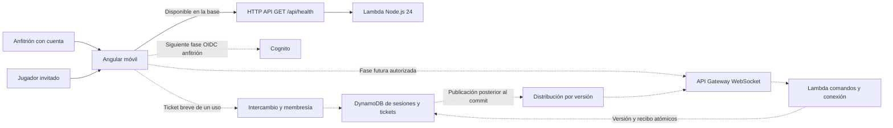

# Arquitectura de Mesa de Rol

## Contexto y frontera

El anfitrión coordina la sesión y cada participante consulta el orden de turnos desde un teléfono. Angular 22.3 y NgRx SignalStore 22.0.1 representarán el último estado confirmado por el servidor. La base actual implementa salud HTTP y cálculo puro de turnos. La plantilla SAM reserva un HTTP API, Lambda Node.js 24, una tabla DynamoDB y logs de 14 días.

La única ruta pública de la plantilla es `GET /api/health`. `STAGE` y `PRODUCT_SLUG` identifican la ejecución de salud. Las rutas de sesión y la API WebSocket se incorporarán con sus controles de identidad y autorización.

[Fuente del diagrama](./diagram.mmd)

## Identidad e ingreso de jugadores

El anfitrión se autentica con Cognito y conserva la propiedad de la sesión. Puede crear y revocar una invitación limitada a una mesa. El intercambio de la invitación comprobará secreto, vigencia, capacidad y estado de la mesa y asignará una identidad de invitado. La aplicación del jugador obtiene un ticket opaco de un solo uso vinculado a sesión, identidad y rol. El secreto completo viaja por TLS y se guarda su hash.

El ticket de conexión propuesto dura 60 segundos. El handler de conexión consume el ticket con una condición atómica `consumedAt` ausente y `expiresAt > now`, y registra la conexión para la misma identidad. Los reintentos de un handshake fallido obtienen otro ticket mediante el intercambio autorizado. Un ticket usado no admite una segunda conexión. Esta operación requiere una transacción real y una prueba de dos conexiones simultáneas.

La API WebSocket tendrá un autorizador de conexión. Cada comando de una conexión vuelve a comprobar sesión, membresía y permiso vigente, porque el autorizador de API Gateway se evalúa únicamente al conectar. El usuario no elige otro anfitrión o sesión mediante la carga útil. Evitar registrar la query del handshake, secretos de invitación o tickets. [Autorizadores WebSocket](https://docs.aws.amazon.com/apigateway/latest/developerguide/apigateway-websocket-api-lambda-auth.html)

## Datos y accesos propuestos

| Entidad | Partición | Ordenamiento | Conservación inicial propuesta |
| --- | --- | --- | --- |
| Sesión y estado | `HOST#host` | `SESSION#session` | Sin TTL durante su actividad. |
| Miembro | `SESSION#session` | `MEMBER#identity` | Ligada al ciclo de la sesión. |
| Ticket | `TICKET#hash` | `CONNECT` | `expiresAt` en segundos, 60 segundos de vigencia lógica. |
| Conexión | `SESSION#session` | `CONNECTION#connectionId` | Renovación por actividad y caducidad de limpieza. |
| Recibo | `SESSION#session` | `IDEMP#actor#operation#digestKey` | Ventana de reintentos de 24 horas. |
| Evento de versión | `SESSION#session` | `EVENT#version` | Última ventana de recuperación y snapshot actual. |

El stage y el producto son dueños de su tabla. Cada consulta resuelve primero la pertenencia. TTL sirve para limpieza diferida y el servidor comprueba la caducidad lógica antes de usar tickets, conexiones o recibos. DynamoDB puede conservar un ítem varios días después de su vencimiento. [TTL de DynamoDB](https://docs.aws.amazon.com/amazondynamodb/latest/developerguide/TTL.html)

## Turnos, concurrencia e idempotencia

`services/domain/turn.mjs` recibe un estado con `sessionId`, `turnOrder`, `activeIndex`, `round` y `version`. `advanceTurn` valida el orden, calcula el índice siguiente, incrementa la ronda al volver al primer participante e incrementa la versión. El comando exige `actorId`, `idempotencyKey` y `expectedVersion`. La autorización del anfitrión corresponde al servicio de aplicación antes de invocar la regla.

El resultado incluye el estado propuesto y un recibo con digest de la operación. El recibo se obtiene exclusivamente del almacenamiento de la aplicación. Para una repetición, el dominio devuelve la respuesta original aunque la sesión ya tenga otra versión. Ese resultado es una respuesta al cliente y conserva el estado guardado actual. Reutilizar el recibo con otro cuerpo, actor o sesión produce `IDEMPOTENCY_CONFLICT`. Un comando nuevo con una versión anterior produce `VERSION_CONFLICT`.

El adaptador futuro ejecuta `TransactWriteItems` para actualizar el estado con condición `version = expectedVersion` y guardar el recibo con `attribute_not_exists`. La condición de pertenencia se incorpora a la transacción sobre su ítem. El evento de la versión se escribe en la misma transacción para poder distribuirlo después. Si otro comando ganó, el cliente recibe `409` o el recibo ya confirmado de su solicitud. Las pruebas puras simulan el conflicto al aplicar un segundo comando al estado ganador. La garantía entre dos Lambdas depende de la transacción de persistencia. [Transacciones DynamoDB](https://docs.aws.amazon.com/amazondynamodb/latest/developerguide/transaction-apis.html)

## Desconexión y recuperación

La transmisión de un estado ocurre después de confirmarlo. Si falla un envío, el avance sigue confirmado. El consumidor identifica los eventos por sesión y versión y el cliente ignora duplicados y solicita recuperación si hay un salto. En una reconexión autorizada se lee un snapshot consistente y se solicitan los eventos posteriores a la última versión conocida. Si expiró la ventana, se usa el snapshot completo.

La desconexión elimina o marca la conexión como inactiva de forma idempotente. Una limpieza por caducidad cubre callbacks ausentes. El turno de una persona permanece en el orden hasta una acción explícita del anfitrión. La respuesta incluye el identificador de solicitud para resolver confirmaciones tardías. El estado de conexión es distinto del estado de la partida.

## Infraestructura, retención y costes

La tabla usa capacidad bajo demanda, cifrado, PITR y `expiresAt` como TTL. En producción tiene protección de borrado. `Retain` conserva la tabla al borrar o reemplazar el stack. Los logs de API y Lambda vencen a los 14 días y el rol de salud sólo tiene escritura en su grupo de logs. Las funciones futuras recibirán permisos por tabla y operación. El publicador WebSocket usará `execute-api:ManageConnections` limitado a la API y el stage correspondientes.

La propuesta inicial conserva sesiones cerradas durante 90 días y recibos 24 horas, con plazos visibles al anfitrión. El cierre revoca ingresos antes de programar limpieza. La retención de sesiones será una opción explícita del producto antes del piloto con datos persistidos. La tabla retenida, PITR, logs, mensajes WebSocket y conexiones generan costes incluso cuando el anfitrión usa el producto poco. El plan comercial deberá relacionar límites de mesas y participantes con ese consumo. La base actual tiene sólo fixtures ficticios.

Los ambientes definidos en `infra/environments.json` se promueven de `development` a `testing` y a `main`, asociado a `production`. Los stacks y datos se separan por ambiente. SAM recibe la región en cada ejecución. Una versión se prueba con salud y aislamiento antes de considerar un corte de negocio.

La publicación posterior al commit justifica DynamoDB Streams o una cola con consumidores idempotentes en la fase WebSocket. Los turnos y la decisión de conexión son operaciones breves transaccionales. Step Functions se evaluará únicamente al existir un proceso prolongado con espera y compensación.

[ADR](./adr/0001-fundacion-serverless.md) · [Producto](../PRODUCTO.md) · [Plan](../../plan/architecture-foundation-1.md)
